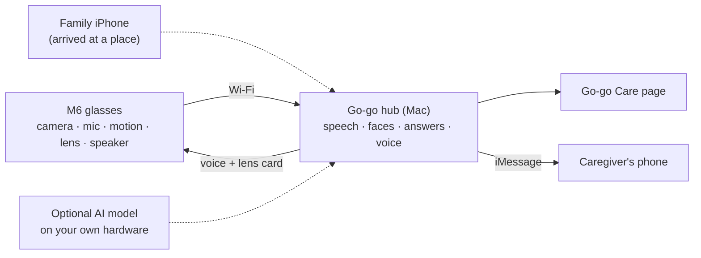

# Go-go

**Smart glasses that help people living with dementia handle everyday moments on their own, and let their caregiver know when it matters.**

Put the glasses on like any other pair. When you need a reminder, say **"Go-go"** or touch the right side, and ask:
*"Who is this?"*, *"Where are we?"*, *"What's next?"* You hear a short, calm answer and see it on the lens. Ask again,
and you get the same calm answer, never "you already asked."

Go-go runs on MicroLumin M6 glasses, with a hub on a home Mac and a care page for the family.

**[Watch the demo video](https://youtu.be/VFcCb8kKdmE)** · **[Try it in your browser](https://gogo-demo.vercel.app)**

---

## Why Go-go

For someone living with dementia, small moments get hard: a familiar face whose name won't come, not knowing where
you are or what's happening today, asking the same question again and again. Each of those moments means asking
someone else for help. Over time that takes away independence and wears out caregivers, who are usually family.

Around 57 million people live with dementia worldwide ([WHO](https://www.who.int/mediacentre/factsheets/fs362/en/)).
Go-go is built to give them back the small moments, and to keep the people who care for them close when it matters.

## What it does

### For the person wearing it

| | |
|---|---|
| **Knows the people around you** | Look at someone, and Go-go tells you who they are. Nod or say "yes" to hear more, or ask "What's his favorite food?" |
| **Tells you where you are** | "Where are we?" and "Why am I here?", answered from notes the family writes |
| **Keeps your day on track** | "What's next?" reads today's plan, with a calm heads-up before each item |
| **Remembers the errands** | Arrive at the store, and Go-go reads your shopping list |
| **Never makes you feel it** | The same calm answer every time. "Say that again", "slower" and "stop" all work. |
| **Answers the way you already do** | Yes or no by voice, or with a nod or a shake of the head |
| **Stays with you** | Gogo the squirrel lives on the lens: it waves when it introduces someone and points at lists |

### For the caregiver

| | |
|---|---|
| **Alerts when it matters** | "I want to go home" or a detected fall sends an iMessage right away, with the time and place |
| **Go-go Care** | A live page with the conversation, who was recognized, repeated questions and alerts |
| **Easy to keep up to date** | Everything Go-go knows lives in plain text files. Anyone in the family can edit them. |

## How it works



1. **The glasses** stream microphone audio, camera frames and motion data to the hub, and show the lens.
2. **The hub** hears the wake word, turns speech into text, matches enrolled faces and picks the answer from the
   family's notes. For questions outside the notes, an optional AI model on your own hardware gives a short, careful
   answer. It never guesses about people or health.
3. **The answer** comes back as speech in the glasses' speaker and a two-line card on the lens. Black is
   see-through on the M6, so the lens never blocks your view.
4. **Caregivers** get an iMessage for distress or a fall, and can follow the day on Go-go Care.

## Privacy and safety

- **Runs on the family's own devices.** Speech, face matching and answers are processed on the hub, not by a public
  cloud AI.
- **Consent first.** A face is only added with that person's consent. Unknown faces are never stored.
- **Bystanders stay private.** Speech from people nearby is never logged.
- **Calm by design.** Go-go never quizzes, never corrects and never says "you already asked."
- **What leaves the house:** caregiver alerts go through Apple's iMessage. The Go-go Care weather panel looks up the
  forecast for a saved place (Open-Meteo); nothing else is sent with it.

Go-go is not a medical device. Fall detection is experimental and not a replacement for emergency services.

## Try it without glasses

- **Web demo:** an interactive lens and Go-go Care page, built from the real answers. Build it with
  `python3 web-demo/build.py` (see `web-demo/`).
- **Simulator:** open `sim/index.html` in a browser, or run the hub and go to `http://localhost:9100/sim/`.

## Set it up

**You need:** a Mac with Apple Silicon, [uv](https://docs.astral.sh/uv/), MicroLumin M6 glasses with Developer Mode
on, and Android Studio (JDK 17) to build the glasses app.

```bash
git clone https://github.com/ShrikarSwami/recall.git && cd recall

# 1. Your details: name, wake word, caregiver, phone numbers (kept out of git)
cp config/app.example.json config/app.local.json
cp config/reminders.example.md config/reminders.local.md

# 2. The hub
cd hub
uv sync
uv run pytest -q                                   # runs without glasses or network
LUCIA_DRY_RUN=1 uv run python -m lucia.server      # http://localhost:9100 (no real texts while dry-run is on)

# 3. Go-go Care
python3 ../gogo-standalone/care/server.py          # http://localhost:9300/dashboard/

# 4. The glasses app
cd ../glasses-app
./gradlew assembleDebug
adb install -r app/build/outputs/apk/debug/app-debug.apk
```

Remove `LUCIA_DRY_RUN=1` when you're ready for real caregiver texts. Connection details for the glasses are in
[docs/GLASSES_RETURN.md](docs/GLASSES_RETURN.md).

## Make it yours

| To change | Edit |
|---|---|
| What Go-go knows: people, places, everyday questions, today's plan | `knowledge/` (plain markdown, hundreds of questions to start from) |
| Name, wake word, caregiver, alert numbers | `config/app.local.json` |
| Shopping lists and reminders | `config/reminders.local.md` (copy `reminders.example.md`) |
| Familiar faces (with consent) | `faces/<person>/`, 3 photos each. Never committed. |
| Arrival at a place from an iPhone | [docs/SHORTCUT_API.md](docs/SHORTCUT_API.md) |

## Project layout

| Folder | What it is |
|---|---|
| `hub/` | The brain: speech, faces, answers, voice, alerts (Python, FastAPI) |
| `glasses-app/` | The app on the M6: camera, mic, keys and sensors to the hub; shows the lens |
| `lens/` | What the glasses display, including Gogo the squirrel |
| `gogo-standalone/` | Go-go Care page and server, squirrel art and tools |
| `caregiver-web/` | The hub's built-in caregiver page |
| `knowledge/` | Everything Go-go knows, in plain markdown |
| `sim/`, `web-demo/` | Try Go-go in a browser |
| `config/` | Settings. Copy the example to `app.local.json`. |
| `docs/` | Spec, hardware notes, APIs |

## Status and roadmap

Working end to end on real M6 glasses: wake word and touch, face recognition, spoken and on-lens answers, nod
answers, schedule, shopping lists, fall and distress alerts, and Go-go Care.

**Next:**
- Testing with people living with dementia and their families
- A private "About me" form so families can fill in the knowledge without editing files
- Tuning fall detection on real-world data
- Location and head-motion signals on Go-go Care from the glasses themselves

## Team and credits

Built by **Team BB**: Shrikar, Abhiram, Isha and Sid, at the Worn Smart Glasses Hackathon (November 2026).

Go-go builds on [face_id](https://github.com/ShrikarSwami/face_id) and lessons from an earlier dementia-assistant
project by Shrikar, along with FastAPI, mlx-whisper, Ollama, macOS speech and Apple Messages. Full disclosure is in
[docs/SUBMISSION.md](docs/SUBMISSION.md) and [docs/SPEC.md](docs/SPEC.md).

## Contributing

Read [AGENTS.md](AGENTS.md) first. Two rules:

1. **Never commit the MicroLumin SDK kit.** It's confidential, and this repo is public.
2. **No real personal data in git.** Phone numbers, keys and photos go in gitignored files (`config/*.local.*`,
   `.env`, `faces/`).
